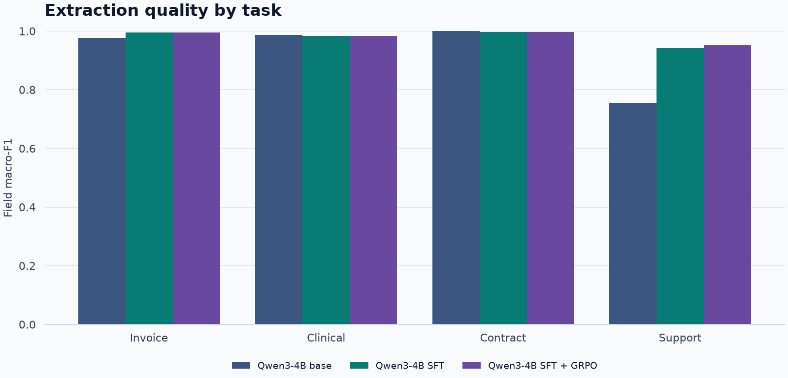
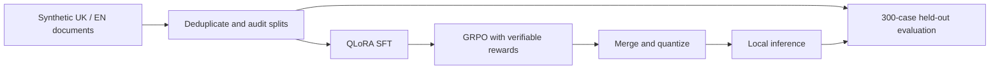

# Verifine SLM

[](https://github.com/Galactic717/verifine-slm/actions/workflows/ci.yml)

**Local structured extraction for Ukrainian and English documents.** Verifine fine-tunes small language models to return typed fields grounded in the source text and abstain with `null` when a field is missing.

[Українська](README.uk.md) · [Replay the experiment](#replay-the-experiment) · [Run locally](#windows-quick-start) · [Ablation report](docs/ABLATION_REPORT.md)

## Results

Qwen3-4B evaluated on the same **300 synthetic held-out documents**, split evenly across Ukrainian and English.

| Qwen3-4B checkpoint | Field macro-F1 | Valid schema | All fields correct |
| --- | ---: | ---: | ---: |
| Base | 0.9468 | 98.67% | 77.67% |
| QLoRA SFT | 0.9839 | 100% | 92.67% |
| QLoRA SFT + GRPO | **0.9853** | **100%** | **93.00%** |

SFT accounted for most of the gain. GRPO corrected one additional document (`p = 1.0`, exact McNemar test). The separate Gemma 4 E4B GGUF baseline reached **0.9553 macro-F1** and **91.33% schema validity**. [Raw predictions and statistics](benchmarks/README.md)



The same Q4_K_M checkpoint served **7.33 requests/s** with llama.cpp and **4.21 requests/s** with Ollama at four concurrent requests. End-to-end p95 was **779 ms** and **3,659 ms**, respectively, on an RTX 5080. [Serving protocol and cost assumptions](docs/ABLATION_REPORT.md#serving-on-the-same-qwen-q4_k_m-gguf)

## Replay the experiment

Regenerate the synthetic dataset and open a Gradio replay of the 300 recorded base and post-training predictions. The replay runs on CPU using the reports committed here.

```bash
python -m pip install -e ".[demo]"
verifine data --seed 42
python scripts/prepare-space.py benchmarks/qwen-ablation/base.json benchmarks/qwen-ablation/grpo.json
python artifacts/space/app.py
```

<details>
<summary>See a recorded Ukrainian support example</summary>

The source asks to lower a priority and contains an archive batch ID. Qwen base used that batch ID as the ticket ID. The post-trained checkpoint kept the requested priority and returned `null` for the missing ticket ID.

```diff
 {
   "tool": "assign_priority",
   "arguments": {
-    "ticket_id": "Spruce-GO0006",
+    "ticket_id": null,
     "priority": "low"
   }
 }
```

The replay contains the source and both recorded responses for `support-go0006`.

</details>

## Pipeline

The dataset covers invoices, contracts, fictional clinical notes and support action proposals. Shared Pydantic contracts drive prompting, evaluation and the inference gateway. Source checks, label accuracy, abstention and tool arguments contribute to the deterministic reward.



## Windows quick start

Open PowerShell in the project directory. Python 3.13 is used in this example.

```powershell
py -3.13 -m venv .venv
.\.venv\Scripts\python.exe -m pip install -e ".[dev,report]"
.\.venv\Scripts\verifine.exe data
.\scripts\start-llama.ps1
```

The launcher uses the installed Gemma GGUF under `%LOCALAPPDATA%\Programs\llama.cpp` and loopback port **9940**. To serve a different local GGUF, pass `-ModelPath` and `-Alias`. The file paths and GPU settings in the existing llama.cpp launcher can also be reused by pointing Verifine at its running URL and alias.

From another PowerShell window in the project directory:

```powershell
.\.venv\Scripts\verifine.exe eval --concurrency 4 --output artifacts/eval/gemma-base.json
.\.venv\Scripts\verifine.exe bench --concurrency 4 --usd-kwh 0.15 --output artifacts/eval/gemma-serving.json
.\.venv\Scripts\verifine.exe gateway
```

The gateway is available at `http://127.0.0.1:8088`. Open `/docs` to send a structured request or start with:

```powershell
$request = @{task = "invoice"; document = "Invoice INV-1. Supplier: North Paper. Total due: 12.99 EUR."}
Invoke-RestMethod http://127.0.0.1:8088/v1/extract -Method Post -ContentType application/json -Body ($request | ConvertTo-Json)
```

Use `VERIFINE_BACKEND`, `VERIFINE_BACKEND_URL` and `VERIFINE_MODEL` to switch engines. `VERIFINE_GATEWAY_KEY` enables bearer authentication for inference routes. `/healthz` reports gateway liveness and `/metrics` exposes Prometheus request, latency and token counters. [Verstak provider settings](integrations/README.md)

## Data and reward

`verifine data` writes `train.jsonl`, `validation.jsonl`, `golden.jsonl` and a SHA-256 manifest. The default seed is 42. MinHash proposes near-duplicate candidates and the split audit checks cross-split shingle similarity exhaustively. Each document layout family belongs to one split. Imported JSONL via `--source` goes into training only and is marked non-synthetic. The regex scrub covers common phone, email and numeric identifier patterns. Use synthetic fixtures or pre-scrubbed, licensed documents.

The reward gives invalid JSON or schema violations zero. For a valid object, it combines normalized label accuracy, source-span grounding, abstention on absent fields and tool arguments where applicable. Typed values receive exact normalization. Support predictions propose tool calls without executing them.

## Train on WSL2 and CUDA

Use an original Qwen3‑4B‑Instruct Safetensors snapshot. The offline scripts use the model revision pinned in the configs from the Hugging Face cache. Set `VERIFINE_QWEN_MODEL` to select an existing snapshot elsewhere, including a Windows cache mounted in WSL. Stop GPU inference before training when GPU memory is limited.

```bash
uv venv ~/.local/share/verifine-train
source ~/.local/share/verifine-train/bin/activate
uv pip install torch==2.9.1 --index-url https://download.pytorch.org/whl/cu128
uv pip install -e '.[train]'

verifine data --seed 42
bash scripts/start-wsl-train.sh sft
bash scripts/start-wsl-train.sh grpo
bash scripts/run-qwen-ablation.sh
```

SFT computes loss on the completion only and checks that the rendered JSON fits the token budget. GRPO samples groups of generations and logs the reward components to JSONL. The default GRPO profile mixes in train-only archival distractors. Both stages use NF4, BF16, PEFT LoRA, gradient checkpointing and the paged 8-bit optimizer. MLflow logs locally. Use `--resume-from-checkpoint` with the corresponding checkpoint and stage. `configs/gemma4_e4b_sft.yaml` is the Gemma text-training profile for an existing original Gemma snapshot.

`run-qwen-ablation.sh` evaluates base, SFT and SFT+GRPO under the same NF4 decoding settings and writes new results to `artifacts/eval/qwen-ablation`. `verifine compare` reports paired bootstrap intervals and exact McNemar for all fields correct. Assess serving latency with the streaming benchmark. The batched Transformers ablation reports batch timing. For compatible HTTP providers, `eval --logprobs` adds confidence coverage and a Brier score using geometric mean token probability as a proxy for document confidence.

A remote baseline is optional and requires an existing API key and the explicit synthetic-only remote flag. Supply current input and output prices when reporting API cost. The harness accepts OpenAI-compatible and Anthropic endpoints.

```bash
verifine eval --backend openai --url https://api.openai.com/v1 \
  --model YOUR_MODEL_ID --api-key-env OPENAI_API_KEY --allow-remote \
  --output benchmarks/cloud.json
```

## Export and serve

```bash
python -m verifine.serve.export merge --base "$VERIFINE_QWEN_MODEL" \
  --adapter artifacts/qwen-grpo --output artifacts/qwen-merged
python -m verifine.serve.export gguf --model artifacts/qwen-merged \
  --converter /path/to/llama.cpp/convert_hf_to_gguf.py \
  --quantizer /path/to/llama.cpp/build/bin/llama-quantize \
  --output artifacts/verifine-qwen-Q4_K_M.gguf
```

Use the same llama.cpp source release for conversion and quantization. Install its converter dependencies in the environment used by the export command. `export awq` and `export fp8` use LLM Compressor in its own compatible environment. AWQ reads calibration examples from the training split. [LLM Compressor](https://docs.vllm.ai/projects/llm-compressor/en/latest/examples/awq/)

Set `VERIFINE_MODEL_DIR` to the absolute merged Safetensors directory before starting vLLM on port 8091 or SGLang on port 8092. Start one GPU engine at a time.

```bash
docker compose -f serve/docker-compose.vllm.yml up
docker compose -f serve/docker-compose.sglang.yml up
docker compose -f serve/docker-compose.ollama.yml up -d
docker compose -f serve/docker-compose.ollama.yml cp serve/Modelfile ollama:/tmp/Modelfile
docker compose -f serve/docker-compose.ollama.yml exec ollama ollama create verifine -f /tmp/Modelfile
```

Use `verifine bench --backend vllm --url http://127.0.0.1:8091/v1 --model verifine` with `--output` to benchmark vLLM. Use the corresponding backend and URL for SGLang and Ollama (port 11435). For same-model comparisons hold the checkpoint, workload, token cap and decoding settings constant. Report quantization differences and run concurrency levels separately. `scripts/plot-benchmarks.py` builds quality, reward and cost plots from recorded files.

## Demo and release

The replay can be packaged as a CPU-hosted Space. The release guide covers staging model artifacts and the synthetic dataset. [Dataset card](docs/DATASET_CARD.md) · [Model card](docs/MODEL_CARD.md) · [Release guide](docs/RELEASE.md)

## Development checks

```bash
python -m ruff check .
python -m ruff format --check .
python -m mypy
python -m pytest -q
```
