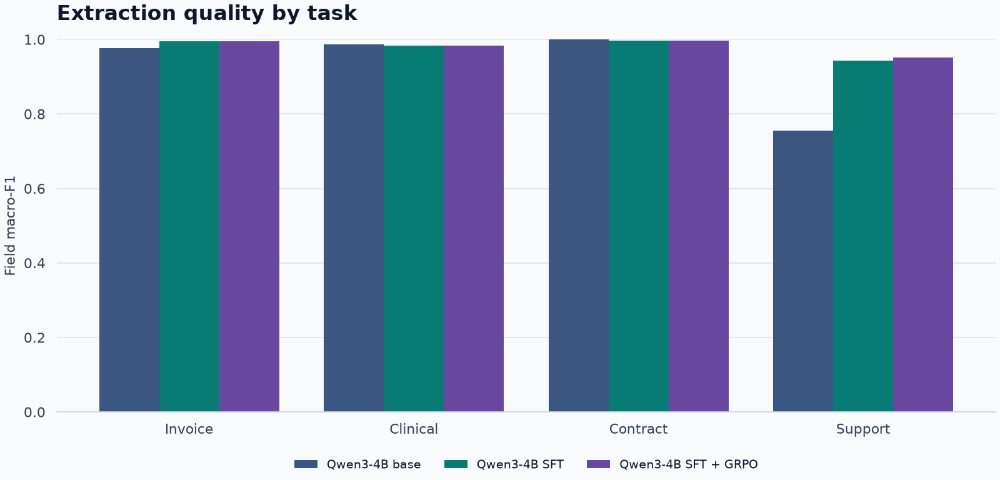

# Verifine SLM

[](https://github.com/Galactic717/verifine-slm/actions/workflows/ci.yml)

**Локальна структурована екстракція з українських та англійських документів.** Verifine донавчає малі мовні моделі повертати типізовані поля й залишати `null`, коли потрібного факту в джерелі немає.

[English](README.md) · [Демонстрація без GPU](#демонстрація-без-gpu) · [Запуск на Windows](#запуск-на-windows) · [Звіт експериментів](docs/ABLATION_REPORT.md)

## Виміряний результат

Усі три версії Qwen3‑4B пройшли ті самі **300 синтетичних контрольних прикладів**, порівну українською й англійською.

| Qwen3‑4B | Macro‑F1 полів | Валідна схема | Усі поля правильні |
| --- | ---: | ---: | ---: |
| Базова модель | 0,9468 | 98,67% | 77,67% |
| QLoRA SFT | 0,9839 | 100% | 92,67% |
| QLoRA SFT + GRPO | **0,9853** | **100%** | **93,00%** |

Основний приріст дала SFT. Після GRPO модель виправила ще один документ (`p = 1,0`, точний тест Мак-Немара). Окремий контрольний прогін Gemma 4 E4B GGUF дав **0,9553 macro‑F1** і **91,33% валідності схеми**. [Протокол і сирі результати](docs/ABLATION_REPORT.md)



## Демонстрація без GPU

Відтворіть 300 збережених відповідей до й після навчання. Команди використовують синтетичний набір і звіти з репозиторію.

```powershell
python -m pip install -e ".[demo]"
verifine data --seed 42
python scripts/prepare-space.py benchmarks/qwen-ablation/base.json benchmarks/qwen-ablation/grpo.json
python artifacts/space/app.py
```

## Запуск на Windows

Відкрийте PowerShell у каталозі проєкту.

```powershell
py -3.13 -m venv .venv
.\.venv\Scripts\python.exe -m pip install -e ".[dev,report]"
.\.venv\Scripts\verifine.exe data
.\scripts\start-llama.ps1
```

Скрипт підхоплює встановлений GGUF із `%LOCALAPPDATA%\Programs\llama.cpp` і відкриває порт **9940** на loopback. Якщо модель уже запущено вашим лаунчером, вкажіть її URL і псевдонім у `VERIFINE_BACKEND_URL` та `VERIFINE_MODEL`.

В іншому вікні PowerShell запустіть оцінювання або шлюз.

```powershell
.\.venv\Scripts\verifine.exe eval --concurrency 4 --output artifacts/eval/gemma-base.json
.\.venv\Scripts\verifine.exe gateway
```

Swagger UI доступний за адресою `http://127.0.0.1:8088/docs`. Викликайте `POST /v1/extract` із полями `task` і `document`. Підтримувані завдання мають імена `invoice`, `clinical`, `contract`, `support`. Маршрут `/metrics` повертає метрики Prometheus. [Підключення до Verstak](integrations/README.md)

Після експорту Qwen GGUF запустіть модель командою `.\scripts\start-llama.ps1 -ModelPath .\artifacts\verifine-qwen-Q4_K_M.gguf -Alias verifine-q4`. Для шлюзу встановіть `$env:VERIFINE_MODEL = "verifine-q4"`. [Навчання й експорт моделі](README.md#export-and-serve)

## Навчання й оцінювання

Скрипти WSL2 використовують зафіксовану в конфігурації версію Qwen3‑4B‑Instruct із кешу Hugging Face. Задайте `VERIFINE_QWEN_MODEL`, щоб підключити наявний каталог Safetensors з іншого місця, зокрема з кешу Windows. Перед навчанням звільніть відеопам’ять, зупинивши локальний сервер моделі.

```bash
verifine data --seed 42
bash scripts/start-wsl-train.sh sft
bash scripts/start-wsl-train.sh grpo
bash scripts/run-qwen-ablation.sh
```

Інструкції зі встановлення середовища CUDA, експорту LoRA, створення GGUF, запуску vLLM, SGLang і Ollama, хмарного порівняння та підготовки демо наведені в [README англійською](README.md). Проєкт зберігає журнал компонентів винагороди, MLflow-метрики та сирі оцінки для відтворення таблиць.
